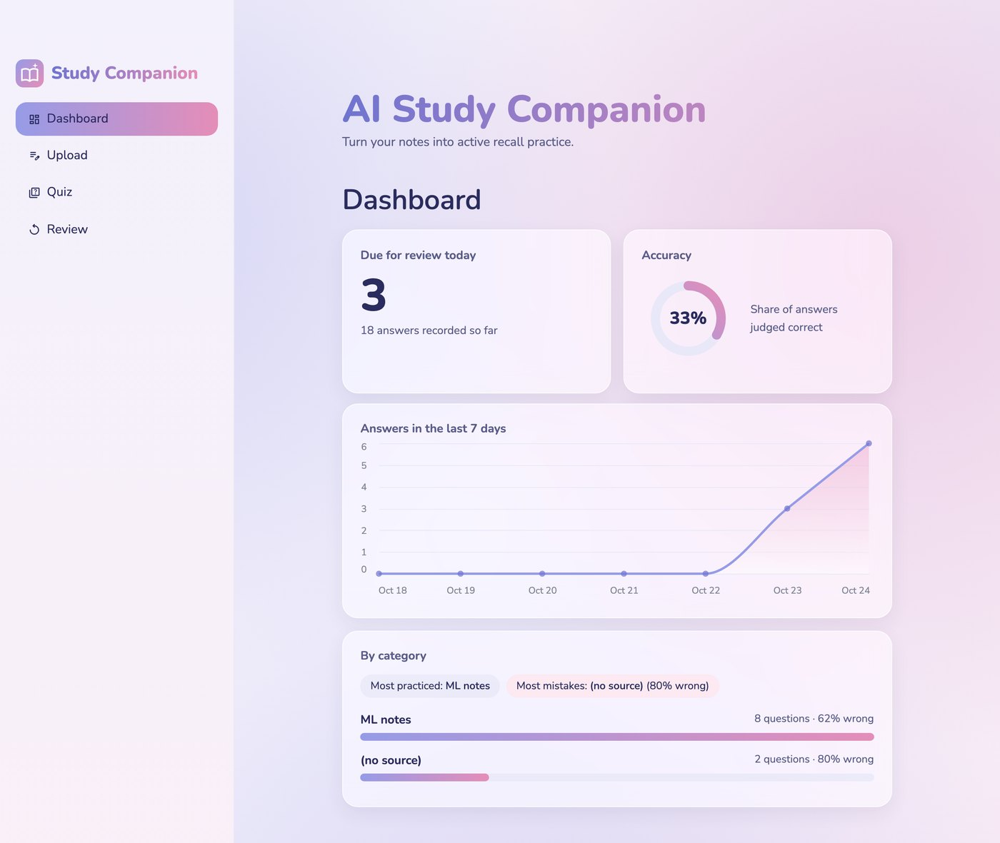
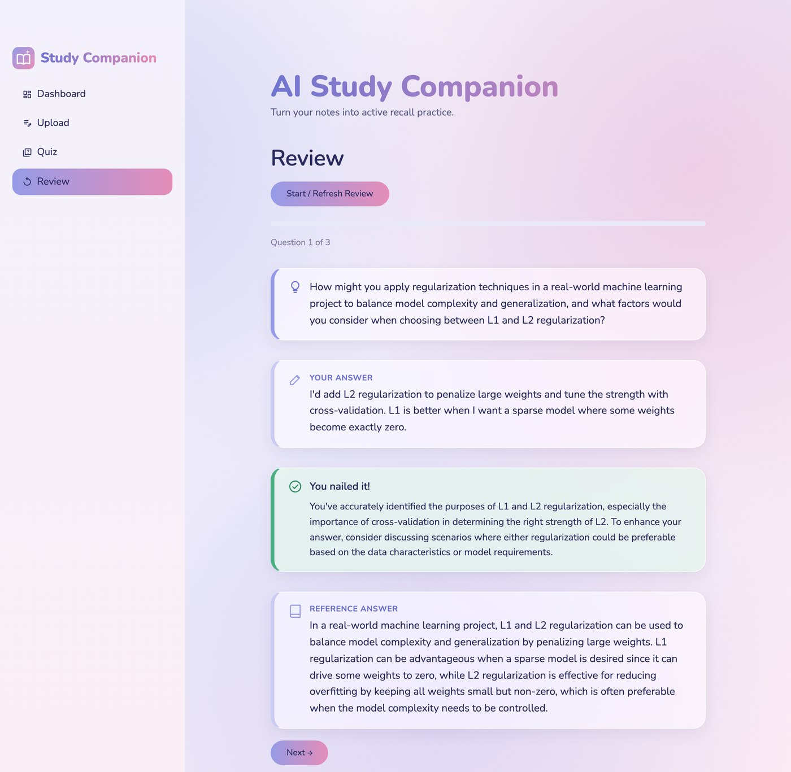

# AI Study Companion

An AI study tool that turns your notes into active recall practice. Paste in your notes, and the app retrieves the most relevant passages, generates Socratic follow-up questions with an LLM, judges your answers, and schedules reviews with a spaced repetition algorithm (SM-2) so weak topics come back sooner.





## Features

- **Note ingestion**: paste text notes, which are split into paragraph-based chunks
- **Semantic retrieval**: chunks are embedded with OpenAI `text-embedding-3-small` and matched to a topic by cosine similarity. Embeddings are stored in SQLite, so the index survives restarts
- **Socratic questions**: an LLM generates a follow-up question from the retrieved chunk
- **Answer feedback**: the LLM judges your answer against the source note and returns specific feedback plus a reference answer
- **Spaced repetition**: a simplified SM-2 scheduler doubles the review interval on correct answers and resets it to 1 day on wrong ones
- **Review queue**: a min-heap surfaces the questions that are due, earliest first; the UI walks through them one at a time
- **Dashboard**: questions due today, overall accuracy, answers over the last 7 days, and per-category stats (most practiced, most mistakes) grouped by note source

## Tech Stack

Python, FastAPI, Streamlit, SQLite, OpenAI API, pytest. Deployed on Render.

## Architecture

```
Streamlit UI (src/app.py)
        │  HTTP
        ▼
FastAPI backend (src/main.py)
        │
  ┌─────┼───────────────┬─────────────────┬──────────────┐
  ▼     ▼               ▼                 ▼              ▼
/upload /quiz         /answer           /review        /stats
  │      │               │                 │              │
chunk   retrieve       LLM judges       min-heap of    accuracy,
  │     top chunk      vs. source note  due questions  7-day activity,
embed   (cosine)         │                               per-category
  │      │             update SM-2
  ▼      ▼             schedule
SQLite (notes + embeddings), loaded into an in-memory index on startup
```

**Data flow**

1. **Upload**: a note is split into chunks, each chunk is embedded with the OpenAI embeddings API, and the chunk and its embedding are saved to SQLite. On startup the backend backfills any missing embeddings and loads them into an in-memory index.
2. **Quiz**: given a topic, the app finds the most similar chunk (cosine similarity), and an LLM turns it into a Socratic follow-up question stored in SQLite.
3. **Answer**: an LLM judges the answer against the question's source note and returns feedback and a reference answer; the result is saved and the SM-2 scheduler updates the question's next review date.
4. **Review**: questions whose review date is today or earlier are returned, earliest first.
5. **Stats**: the dashboard reads aggregate accuracy, daily activity, and per-category results from `/stats` and `/stats/categories`.

## Getting Started

```bash
git clone https://github.com/Fiona-7788/ai-study-companion.git
cd ai-study-companion
python3 -m venv .venv
source .venv/bin/activate
pip install -r requirements.txt
```

Create a `.env` file in the project root:

```
OPENAI_API_KEY=your_key_here
```

The SQLite database is created automatically on first start from `schema.sql`.

Start the backend and the UI in two terminals:

```bash
uvicorn src.main:app --reload
streamlit run src/app.py
```

The API docs are available at `http://127.0.0.1:8000/docs`.

## Running Tests

```bash
pytest
```

Tests cover the SM-2 scheduler (including database updates against an in-memory SQLite), the embedding utilities (cosine similarity, zero-vector handling, and retrieval with the OpenAI call mocked), database initialization and the embedding-column migration, embedding persistence and backfill, dashboard statistics, and parsing of the LLM's JSON grading output. None of the tests call the OpenAI API.

## Deployment

The backend is deployed on Render: https://ai-study-companion-604v.onrender.com/docs

> Hosted on Render's free tier, so the first request after a period of inactivity can take about a minute while the service wakes up. The database is recreated empty on each fresh deploy.

## Engineering Notes

- **Memory limit on Render**: the first deployment crashed with an out-of-memory error because `sentence-transformers` (PyTorch) exceeded the 512 MB free-tier limit. I replaced the local model with the OpenAI embeddings API, which removed the heavy dependencies and fixed the crash.
- **Testable design**: the SM-2 scheduling logic was extracted into a pure function (`compute_next_schedule`) separate from database access, so it can be unit tested with fixed dates. The OpenAI client is created lazily so modules import without an API key.
- **Single source of truth for the database**: a duplicated database connection (with a hardcoded path) caused `unable to open database file` errors after moving the project. All modules now share `get_connection()` and the path is derived from the file location.
- **Persisting embeddings**: the index used to live only in memory, so every restart (including free-tier cold starts) made the quiz report "no notes found". Embeddings are now stored as float32 blobs in the `notes` table; `init_db` adds the column to existing databases, and startup backfills older notes.
- **Grounded grading**: the grader receives the question's source note and must return JSON (`is_correct`, `feedback`, `reference_answer`). Parsing is a separate pure function that handles quoted booleans and falls back to the old one-word verdict, so it is unit tested without the API.
- **A test caught a SQL alias bug**: in the per-category query, aliasing the cleaned-up source as `source` made SQLite's `GROUP BY` use the raw `n.source` column, so blank and missing sources were not merged. Renaming the alias fixed it.

## Known Limitations

- Notes are plain text only; PDF upload is planned.
- Questions are linked to their source note by exact content match, so the quiz can fail if no matching note is found.
- Uploading the same text twice creates duplicate notes.
- Categories come from the free-text note source, so different spellings of the same course are counted separately.
- Single user: there are no accounts, and everyone shares one database.

## Future Work

- PDF and slide upload
- Question types that match the exam format (multiple choice, true/false), graded without the LLM
- Deploy the Streamlit frontend and move to a hosted Postgres database so data survives redeploys
- Full SM-2 with an ease factor and graded (0-5) answers